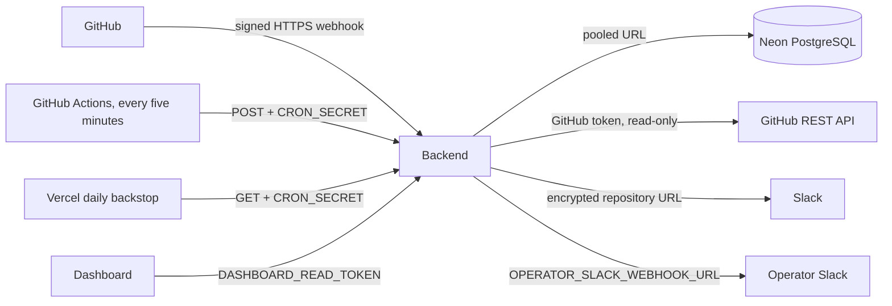

# Architecture

Shipwatch consists of two Vercel projects from this monorepo: the Express backend and
Vite/React dashboard. The backend runs on Vercel's Node runtime and connects to Neon
PostgreSQL using the pooled application URL. Migrations and schema dumps use a direct
connection URL.

## Event path

1. GitHub sends `workflow_run`, `deployment`, or `deployment_status` to the webhook
   route. The backend verifies HMAC-SHA256 against the exact raw request bytes before
   parsing JSON.
2. The request inserts one `webhook_deliveries` row keyed by GitHub's delivery ID and
   returns after the insert/duplicate check. Domain processing is asynchronous with
   respect to acknowledgement and runs on the scheduled sweep, not `waitUntil`.
3. The sweep claims eligible rows using `FOR UPDATE SKIP LOCKED`, applies shared
   idempotent processors, and updates the queue row only while its lock token remains
   current. Failed rows receive bounded exponential backoff; exhausted rows become dead.
4. Domain events and incident/outbox changes share a PostgreSQL transaction. The
   independent alert dispatcher claims outbox rows and sends Slack notifications
   outside the transaction.
5. The dashboard authenticates with a read token, reads only explicit response fields,
   and polls every ten seconds. `/api/internal/stats` is a separate cron-token endpoint.
6. Reconciliation uses GitHub's REST API to repair recent missing workflow/deployment
   events, reusing the webhook processors.

## Boundaries and limitations

Webhook acknowledgement proves only that a delivery row was stored (or had already
been stored), not that the event has been processed. GitHub Actions is the primary
five-minute sweep scheduler; Vercel Cron runs once daily as a Hobby-compatible backstop.
Scheduled GitHub runs can be delayed or disabled after 60 days of inactivity in public
repositories, so stuck events wait for the next successful sweep. Alert delivery is
at-least-once. The dashboard and internal stats route are separate credentials and
should be rotated independently.
